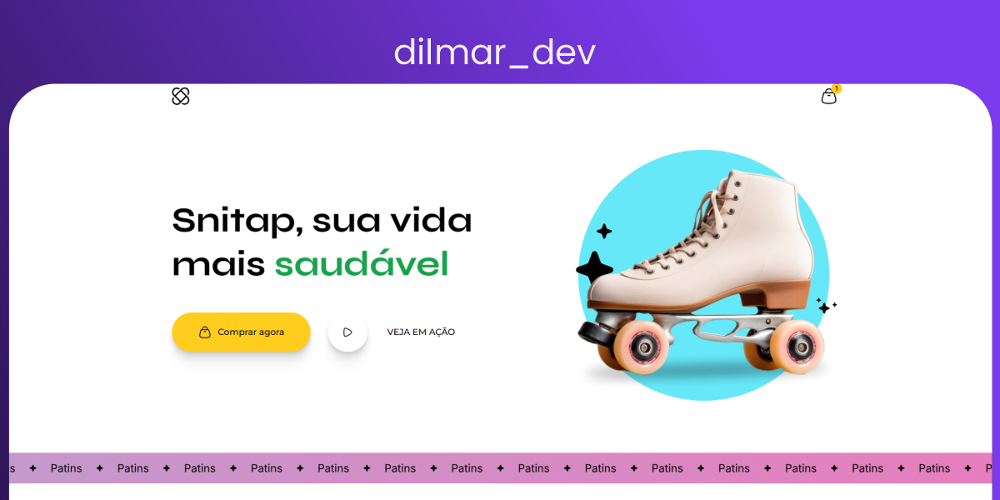

# Snitap 🎿

  

**Snitap** is a landing page concept for a roller skate brand, developed with a focus on CSS animations, visual presentation and front-end development fundamentals.

## 📌 About the Project

This project was built entirely by hand, without the use of AI tools, as part of my journey to improve my front-end development skills.

The main objective was to strengthen my understanding of CSS animations, explore different animation techniques and understand how CSS can bring interfaces to life through movement and transitions.

Rather than relying on pre-built solutions, I challenged myself to understand the logic behind each animation and implement it independently.

## 🎯 Learning Objectives

- Practice CSS animations and keyframes.
- Improve understanding of CSS transitions.
- Explore animation timing and movement.
- Understand how different CSS properties affect animation behavior.
- Develop better control over visual interactions.
- Strengthen problem-solving skills through hands-on practice.

## 🛠️ Technologies

- HTML5
- CSS3

## 💡 What I Learned

This project was an opportunity to move beyond simply writing CSS and start understanding how animations work.

It helped me practice animation logic, experiment with different properties and develop a better understanding of how to create smooth and engaging visual experiences.

## 🚀 Project Status

Completed as a hands-on learning project. Further improvements and experiments may be added as my CSS skills evolve.

---

**Built with curiosity, practice and pure CSS.**

*No AI. Just code, experimentation and learning.*
